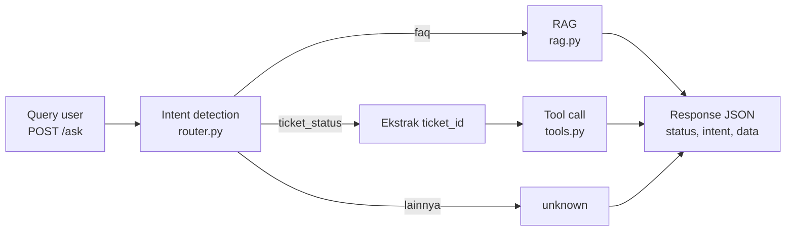

# IT Helpdesk Assistant — End-to-End RAG & AI Agent

Aplikasi backend berbasis FastAPI yang menggabungkan **RAG** untuk menjawab pertanyaan seputar kebijakan dan informasi dari *knowledge base*, serta **router/mini-agent** untuk mengenali permintaan pemeriksaan status tiket dan mengambil datanya melalui *tool call*.

Assignment 4: End-to-End RAG & AI Agent Development (AI Engineering Bootcamp, ReWork Academy).
Disusun oleh: Mochammad Aurich Ilham Wicaksono

> **Status dokumen:** mencakup hasil pengujian secara lokal dan di dalam *container* Docker.

## Struktur Project

```
it-helpdesk-assignment/
├── app/
│   ├── __init__.py
│   ├── main.py       # Entry point FastAPI, endpoint /ask dan /health
│   ├── router.py     # Intent detection + routing ke RAG atau tool call
│   ├── rag.py        # Modul RAG: embedding, FAISS, semantic search, LLM answer
│   └── tools.py      # Modul tool call: pengecekan status tiket
├── data/
│   ├── it_helpdesk_knowledge_base.csv   # Knowledge base (31 FAQ, 6 kategori)
│   └── mock_tickets.csv                 # Data mock (15 tiket)
├── Dockerfile
├── .env.example
├── requirements.txt
└── README.md
```

## 1. Problem Statement

### Objective
Tim People & IT Operations menerima ratusan pertanyaan berulang dari karyawan setiap hari. Proyek ini bertujuan membangun prototipe asisten AI internal yang dapat menangani dua jenis permintaan dalam satu sistem dan dijalankan di dalam *container* Docker.

### Dua jenis permintaan user

| Jenis | Intent | Contoh | Penanganan |
|---|---|---|---|
| Pertanyaan informasi/kebijakan | `faq` | "Berapa jatah cuti tahunan saya?", "Bagaimana cara reset password VPN?" | RAG: mencari informasi yang relevan di *knowledge base* menggunakan *semantic search*, lalu LLM menyusun jawaban |
| Permintaan pemeriksaan data tertentu | `ticket_status` | "Apa status tiket TICKET-0002 saya?" | *Tool call*: mencari data secara langsung di data tiket, bukan melalui pencarian semantik |

### Batasan dan asumsi
- *Knowledge base* dan data tiket hanya menggunakan dua file CSV dari *starter repository*; tidak ada sumber data lain yang digunakan.
- Format ID tiket adalah `TICKET-XXXX` (empat digit). Penulisan lain, seperti `tiket 7`, akan dinormalisasi menjadi `TICKET-0007`.
- Data tiket bersifat *mock* (data contoh) dan statis, serta dibaca dari file CSV, bukan dari sistem tiket yang sebenarnya.
- Setiap *query* diasumsikan hanya memuat satu *intent* atau jenis permintaan.
- Bahasa utama yang digunakan adalah bahasa Indonesia.
- Aplikasi dijalankan secara lokal, tanpa *deployment* ke cloud, baik secara langsung maupun di dalam *container*.

## 2. Desain Workflow



**Alur RAG (`faq`):** *query* → mengubah *query* menjadi *embedding* → mencari tiga hasil teratas (*top-3*) di index FAISS → menyusun *prompt* (Persona/Task/Context/Format) berdasarkan hasil pencarian → LLM menyusun jawaban.

**Alur *tool call* (`ticket_status`):** *query* → mengekstrak `ticket_id` → fungsi `get_ticket_status()` mencari data di `mock_tickets.csv` → mengembalikan informasi tiket berupa subjek, kategori, status, dan pembaruan terakhir.

### Kriteria intent

| Intent | Kriteria |
|---|---|
| `ticket_status` | *Query* memuat ID tiket (`TICKET-XXXX`, termasuk variasi seperti `tiket 7`), atau LLM menilai bahwa pengguna sedang menanyakan status atau perkembangan suatu tiket |
| `faq` | Pertanyaan umum tentang informasi atau kebijakan, termasuk pertanyaan prosedural ("bagaimana cara ..."), yang jawabannya dicari di *knowledge base* |
| `unknown` | Bukan label klasifikasi utama, melainkan mekanisme pengaman. Digunakan jika keluaran LLM tidak memuat `faq` maupun `ticket_status`, misalnya ketika respons kosong atau tidak sesuai format |

Urutan deteksi di `detect_intent()`:
1. Jika *query* memuat ID tiket, sistem langsung menetapkan `ticket_status` tanpa memanggil LLM.
2. Jika tidak, LLM mengklasifikasikan *query* menggunakan *prompt* yang meminta satu label.
3. Jika LLM gagal, sistem menggunakan metode dasar berbasis kata kunci: kata "tiket"/"ticket" yang disertai kata terkait status atau perkembangan.

### Komponen teknis

| Komponen | Pilihan |
|---|---|
| Model untuk menghasilkan jawaban dan mendeteksi *intent* | `gemini-3.5-flash-lite` (parameter model di `rag.py` dan `router.py`) |
| Model *embedding* | `gemini-embedding-001` (parameter model di `rag.py`) |
| Index vektor | FAISS `IndexFlatIP` dengan vektor yang dinormalisasi (*cosine similarity*), top-k = 3 |
| Unit pencarian | Satu baris FAQ yang memuat kategori, pertanyaan, dan jawaban |
| Pembuatan index | Dilakukan sekali saat permintaan RAG pertama (*lazy-loading*), lalu disimpan di memori |
| API key | Variabel *environment* `GEMINI_API_KEY` (disimpan di file `.env` dan tidak di-*commit*) |

### Penanganan error di `/ask`

| Kondisi | Respons |
|---|---|
| *Query* kosong | HTTP 400, `status: error` |
| *Intent* tidak dikenali | `status: error`, `intent: unknown` |
| `ticket_status` tanpa ID tiket | `status: error`, meminta ID tiket |
| Tiket tidak ditemukan | `status: success`, pesan informatif bahwa tiket tidak ditemukan |
| LLM atau layanan eksternal gagal | HTTP 503, `status: error`, pesan bahwa layanan sedang mengalami gangguan |

## 3. Cara Menjalankan

### Prasyarat
- Python 3.11
- API key Gemini

### Tanpa Docker (Windows PowerShell)

```powershell
# 1. Buat dan aktifkan virtual environment
python -m venv venv
venv\Scripts\Activate.ps1

# 2. Install dependensi
pip install -r requirements.txt

# 3. Salin .env.example menjadi .env, lalu isi GEMINI_API_KEY
copy .env.example .env

# 4. Jalankan server dari root project
uvicorn app.main:app --reload --port 8000
```

Di macOS/Linux, aktifkan *virtual environment* dengan `source venv/bin/activate` dan salin file menggunakan `cp .env.example .env`.

Server berjalan di `http://127.0.0.1:8000`. Dokumentasi interaktif (Swagger UI) dapat dibuka melalui `http://127.0.0.1:8000/docs`.

Isi file `.env`:

```
GEMINI_API_KEY=isi_api_key_di_sini
```

### Dengan Docker

Prasyarat: Docker Desktop sudah berjalan dan file `.env` telah berisi `GEMINI_API_KEY`. Hentikan server Uvicorn lokal terlebih dahulu karena *container* akan menggunakan port 8000.

```bash
docker build -t it-helpdesk-assistant .
docker run -p 8000:8000 --env-file .env it-helpdesk-assistant
```

Catatan konfigurasi Docker:
- `requirements.txt` disalin dan dependensinya dipasang lebih dahulu agar lapisan dependensi dapat digunakan kembali melalui *cache* Docker.
- Uvicorn dijalankan dengan `--host 0.0.0.0` agar endpoint dapat diakses dari luar *container*.
- File `.env` tidak disalin ke dalam *image* karena dikecualikan melalui `.dockerignore`. API key hanya diberikan saat *container* dijalankan menggunakan `--env-file`, sehingga tidak ditulis langsung di kode maupun *image*.
- Isi `.env` ditulis tanpa tanda kutip, misalnya `GEMINI_API_KEY=isi_key`, karena `--env-file` akan membaca tanda kutip sebagai bagian dari nilainya.
- Untuk memastikan `.env` tidak tersimpan di dalam *image*, jalankan `docker run --rm it-helpdesk-assistant ls -a /app`. Hasilnya memuat `app`, `data`, `requirements.txt`, `Dockerfile`, dan `.dockerignore`, tanpa `.env`.

### Contoh request

```powershell
Invoke-RestMethod -Uri http://127.0.0.1:8000/ask -Method Post -ContentType "application/json" -Body '{"query":"Berapa jatah cuti tahunan saya?"}'
```

```bash
curl -X POST http://localhost:8000/ask \
  -H "Content-Type: application/json" \
  -d '{"query": "berapa jatah cuti tahunan saya?"}'
```

## 4. Hasil Pengujian

Pengujian dilakukan pada server lokal tanpa Docker melalui endpoint `/ask`. Semua respons memperoleh status HTTP 200. Hasilnya kemudian dibandingkan secara manual dengan isi kedua file CSV.

### 5 skenario wajib

| # | Query | Diharapkan | Intent terdeteksi | Router tepat? |
|---|---|---|---|---|
| 1 | Berapa jatah cuti tahunan saya? | RAG | `faq` | Ya |
| 2 | Bagaimana cara reset password VPN? | RAG | `faq` | Ya |
| 3 | Apa status tiket TICKET-0002 saya? | Tool call | `ticket_status` | Ya |
| 4 | Tolong cek status TICKET-0099 (tidak ada di data) | Tool call | `ticket_status` | Ya |
| 5 | Rekomendasi restoran enak di Surabaya? | Di luar cakupan | `faq` | Ya (diarahkan ke RAG, lalu ditolak dengan jujur) |

**Skenario 1 — RAG**

```json
{
  "status": "success",
  "intent": "faq",
  "data": "Halo! Jatah cuti tahunan bagi karyawan tetap adalah 12 hari, yang dapat diambil setelah Anda memiliki masa kerja minimal 3 bulan. Untuk melihat sisa cuti Anda secara *real-time*, silakan langsung mengecek melalui portal HR pada menu 'Ringkasan Cuti Saya'."
}
```
Observasi: Jawaban sesuai dengan FAQ mengenai jatah cuti (12 hari setelah masa kerja minimal 3 bulan) dan cara melihat sisa cuti melalui menu "Ringkasan Cuti Saya". Tidak ditemukan fakta tambahan di luar *knowledge base*.

**Skenario 2 — RAG**

```json
{
  "status": "success",
  "intent": "faq",
  "data": "Halo! Reset password VPN dapat dilakukan secara mandiri melalui portal self-service IT. Namun, jika akun Anda terkunci, silakan langsung menghubungi tim IT Support untuk mendapatkan bantuan lebih lanjut."
}
```
Observasi: Jawaban sesuai dengan FAQ tentang pengaturan ulang kata sandi VPN, yaitu melalui portal *self-service* IT atau dengan menghubungi IT Support jika akun terkunci.

**Skenario 3 — Tool call, tiket ditemukan**

```json
{
  "status": "success",
  "intent": "ticket_status",
  "data": "Tiket TICKET-0002 — Subjek: Permintaan akses Google Analytics. Kategori: Access. Status: Diproses. Update terakhir: 2026-08-25."
}
```
Observasi: Informasi yang dikembalikan sama dengan data `TICKET-0002` di `mock_tickets.csv`. Jalur ini tidak memanggil LLM. Nama pelapor (`employee_name`) sengaja tidak ditampilkan.

**Skenario 4 — Tool call, tiket tidak ada**

```json
{
  "status": "success",
  "intent": "ticket_status",
  "data": "Tiket TICKET-0099 tidak ditemukan. Mohon periksa kembali ID tiket Anda (format: TICKET-XXXX)."
}
```
Observasi: Data hanya mencakup tiket `TICKET-0001` hingga `TICKET-0015`. Aplikasi tetap berjalan dan mengembalikan pesan yang informatif. Status `success` digunakan karena proses *tool call* berjalan normal, meskipun tiket yang diminta tidak ditemukan.

**Skenario 5 — Query di luar cakupan**

Request: `{"query": "Rekomendasi restoran enak di Surabaya?"}`

```json
{
  "status": "success",
  "intent": "faq",
  "data": "Halo! Mohon maaf, saya belum memiliki informasi tersebut karena di luar cakupan layanan bantuan perusahaan. Untuk rekomendasi restoran, Anda dapat bertanya kepada rekan kerja, namun jika ada kendala terkait IT atau HR, silakan hubungi tim IT Support atau HR melalui tiket."
}
```
Observasi: *Prompt* klasifikasi hanya menyediakan dua label (`faq` dan `ticket_status`). Karena itu, pertanyaan yang tidak berkaitan dengan layanan IT atau HR tetap diarahkan ke `faq`. Komponen RAG kemudian menolak menjawab sesuai instruksi dalam *prompt*. Sistem tidak mengarang jawaban dan mengarahkan pengguna ke IT Support atau HR. Penolakan ini bergantung pada instruksi *prompt*, bukan pada ambang skor *similarity* (lihat bagian Keterbatasan).

### Skenario tambahan

| # | Query | Intent terdeteksi | Hasil |
|---|---|---|---|
| 6 | Status tiket saya sudah sampai mana? (tanpa ID) | `ticket_status` | `status: error`, sistem meminta ID tiket dengan format `TICKET-XXXX` |
| 7 | cek tiket 7 | `ticket_status` | ID dinormalisasi menjadi `TICKET-0007`; data sama dengan CSV (Permintaan monitor eksternal, Hardware, Menunggu Persetujuan, 2026-08-24) |

### Perkiraan waktu respons

| Jalur | Waktu |
|---|---|
| RAG, permintaan pertama (termasuk pembuatan index) | 4,71 detik |
| RAG, permintaan berikutnya | 2,08–2,54 detik |
| *Tool call* (tiket) | 0,02–0,03 detik |
| Router tanpa ID tiket (skenario 6, klasifikasi melalui LLM) | 0,71 detik |

Waktu respons dipengaruhi oleh koneksi dan beban API Gemini. Angka tersebut merupakan perkiraan berdasarkan satu sesi pengujian.

### Uji intent `unknown`
*Query* tanpa makna (`asdfghjkl`, `???`), upaya mengubah instruksi, dan *query* yang sangat pendek (`ok`) semuanya tetap diklasifikasikan sebagai `faq`. *Intent* `unknown` tidak muncul karena *prompt* klasifikasi hanya menawarkan dua label. Cabang `unknown` berfungsi sebagai mekanisme pengaman jika keluaran klasifikasi tidak sesuai. Sementara itu, *query* kosong ditolak lebih awal oleh endpoint `/ask` dengan HTTP 400.

### Ringkasan observasi
- Router mengarahkan seluruh skenario dengan *intent* yang jelas (1–4, 6, dan 7) ke komponen yang sesuai.
- Jawaban RAG sesuai dengan isi *knowledge base*, sedangkan data tiket yang dikembalikan sama dengan data pada CSV.
- Skenario 1 dijalankan dua kali. Fakta utamanya tetap sama (12 hari cuti setelah masa kerja minimal 3 bulan), tetapi redaksi dan kelengkapan informasi berbeda. Pada pengujian pertama, jawaban menyertakan informasi tentang menu "Ringkasan Cuti Saya", sedangkan pada pengujian kedua informasi tersebut tidak muncul.
- Jalur *tool call* jauh lebih cepat karena tidak memerlukan pemanggilan LLM.

### Pengujian di dalam container Docker

Seluruh skenario di atas kembali dijalankan di dalam *container* menggunakan perintah `docker run -p 8000:8000 --env-file .env it-helpdesk-assistant` dengan *query* yang sama. Semua respons memperoleh status HTTP 200.

| # | Query | Intent | Hasil | Waktu |
|---|---|---|---|---|
| 1 | Berapa jatah cuti tahunan saya? | `faq` | 12 hari cuti, masa kerja minimal 3 bulan, serta informasi menu "Ringkasan Cuti Saya" | 4,97 detik (permintaan pertama) |
| 2 | Bagaimana cara reset password VPN? | `faq` | Portal *self-service* IT, atau IT Support jika akun terkunci | 2,25 detik |
| 3 | Apa status tiket TICKET-0002 saya? | `ticket_status` | Data sama dengan CSV (Diproses, 2026-08-25) | 0,03 detik |
| 4 | Tolong cek status TICKET-0099 | `ticket_status` | Pesan bahwa tiket tidak ditemukan | 0,03 detik |
| 5 | Rekomendasi restoran enak di Surabaya? | `faq` | Menolak menjawab dan mengarahkan ke IT Support/HR | 2,24 detik |
| 6 | Status tiket saya sudah sampai mana? | `ticket_status` | `status: error`, meminta ID tiket | 1,40 detik |
| 7 | cek tiket 7 | `ticket_status` | Dinormalisasi menjadi `TICKET-0007`; data sama dengan CSV | 0,12 detik |

Observasi:
- Endpoint `/ask` dapat diakses dari luar *container*, dan API key berhasil dibaca melalui variabel *environment*. Hal ini terlihat dari keberhasilan jalur RAG dalam memanggil Gemini.
- *Intent* dan isi faktual jawaban sama dengan hasil pengujian lokal. Router juga mengarahkan seluruh skenario ke komponen yang sesuai.
- Redaksi jawaban LLM berbeda dari hasil pengujian lokal, misalnya pada skenario 5. Hal ini sejalan dengan sifat keluaran LLM yang tidak selalu sama untuk *query* yang sama, sebagaimana dijelaskan pada bagian Keterbatasan.
- Pola waktu respons serupa dengan pengujian lokal: permintaan RAG pertama paling lambat karena index FAISS perlu dibangun, sedangkan jalur *tool call* hanya memerlukan puluhan milidetik. Selisih kecil antara pengujian lokal dan *container* (misalnya skenario 6: 0,71 detik secara lokal dan 1,40 detik di *container*) masih berada dalam variasi latensi API Gemini.

## 5. Keterbatasan Sistem

1. **Penolakan pertanyaan di luar cakupan bergantung pada *prompt*.** Router hanya memiliki dua label sehingga pertanyaan di luar topik tetap diarahkan ke `faq` (skenario 5). Sistem juga belum menerapkan ambang skor *similarity*. Karena itu, penolakan sepenuhnya bergantung pada instruksi yang diikuti LLM dan hasilnya dapat berbeda jika instruksi tidak dipatuhi.
2. **Jawaban LLM tidak selalu sama.** Redaksi dan kelengkapan jawaban dapat berubah antar-eksekusi untuk pertanyaan yang sama, seperti terlihat pada skenario 1. Parameter `temperature` tidak digunakan karena tidak direkomendasikan untuk model Gemini 3.
3. **Kepemilikan tiket belum diverifikasi.** Siapa pun yang mengetahui ID tiket dapat memeriksa statusnya. Nama pelapor memang tidak ditampilkan, tetapi subjek tiket masih dapat dilihat.
4. **Tidak ada memori percakapan.** Jika pengguna menanyakan status tiket tanpa menyertakan ID (skenario 6), sistem hanya meminta ID tersebut dan tidak melanjutkan konteks secara otomatis pada pesan berikutnya.
5. **Setiap *query* hanya menangani satu *intent*.** Jika satu pertanyaan menggabungkan dua permintaan, misalnya menanyakan status tiket sekaligus jatah cuti, sistem hanya akan mengarahkan pertanyaan ke salah satu komponen.
6. **Deteksi *intent* untuk pertanyaan tanpa ID tiket bergantung pada LLM.** Metode cadangan berbasis kata kunci masih sederhana dan dapat keliru mengklasifikasikan kalimat yang tidak memuat kata kunci yang diharapkan.
7. **Index FAISS disimpan di memori dan dibuat saat permintaan RAG pertama.** Akibatnya, permintaan pertama memerlukan waktu lebih lama (4,71 detik), dan index perlu dibuat kembali setiap kali server dimulai ulang. Pendekatan ini memadai untuk *knowledge base* kecil yang berisi 31 FAQ, tetapi belum sesuai untuk skala yang lebih besar.
8. **Data bersifat statis.** Data tiket diambil dari file CSV contoh, sedangkan *knowledge base* tidak diperbarui secara otomatis.
9. **Sistem bergantung pada API eksternal.** Gangguan pada Gemini API ditangani dengan respons 503, tetapi mekanisme percobaan ulang (*retry*) belum tersedia.
10. **Pengujian masih terbatas.** Evaluasi dilakukan secara manual menggunakan tujuh *query* dan belum mengukur ketepatan router atau kualitas hasil pencarian secara kuantitatif.
